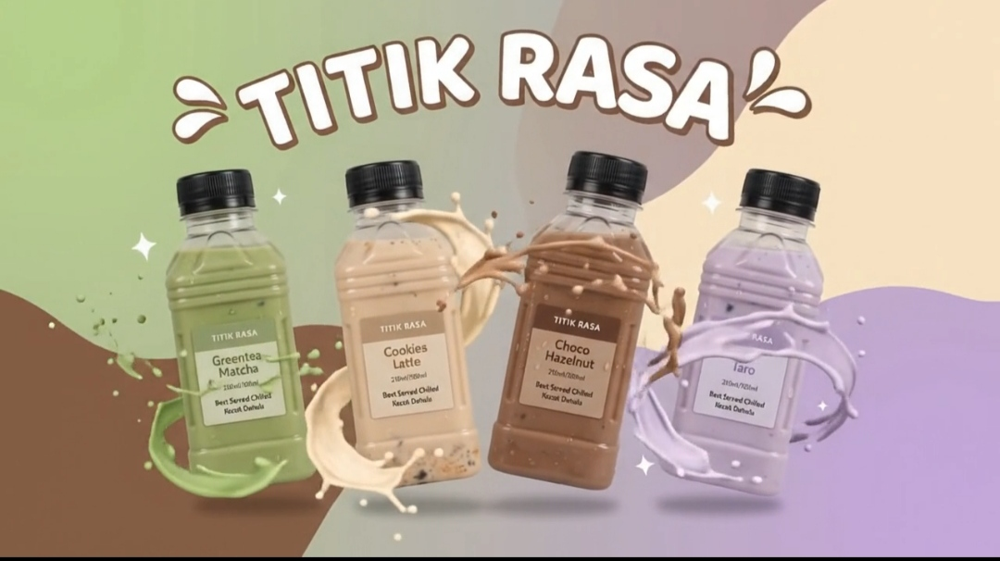

# 🍃 Titik Rasa - Temukan Titik Enakmu

Website e-commerce katalog minuman botol premium **Titik Rasa**. Dibangun menggunakan arsitektur web statis modern (HTML5, Tailwind CSS, dan Vanilla JavaScript) tanpa memerlukan *backend database* yang rumit, sehingga sangat ringan, cepat, dan mudah di-hosting.



## ✨ Fitur Utama Website

- **Katalog Menu Interaktif:** Filter produk berdasarkan kategori (Kopi Series, Teh & Susu) serta fitur pencarian cepat (*live search*).
- **Kustomisasi Pesanan (Modal):** Pelanggan dapat memilih ukuran botol (**250 ml** atau **150 ml**) serta opsi tambahan (*Toppings* seperti *Less Sugar* atau *Extra Es Batu* dengan penyesuaian harga otomatis).
- **Keranjang Belanja Dinamis:** Slide-over drawer keranjang yang responsif, lengkap dengan tombol penambahan/pengurangan kuantitas item.
- **Sistem Promo / Voucher:** 
  - **`TITIKBARU`**: Otomatis mengaktifkan promo **Paket Bundling Spesial (5 Botol 250ml seharga Rp 55.000)** khusus untuk varian mix (kecuali Cookies Latte & Kopi Aren).
  - **`BEBASONGKIR` / `GRATISONGKIR`**: Menggratiskan biaya pengiriman menjadi Rp 0.
  - Keduanya dapat digabungkan secara bersamaan (`TITIKBARU BEBASONGKIR`).
- **Input Nama Pemesan:** Kolom wajib isi nama pemesan di keranjang untuk pencatatan order.
- **Integrasi WhatsApp Checkout:** Pesanan langsung terformat rapi dan terkirim otomatis ke nomor WhatsApp admin beserta detail item, catatan, nama pemesan, dan total pembayaran.
- **Desain Responsif & Elegan:** Menggunakan palet warna *earthy-tone* yang hangat dengan dukungan penuh framework Tailwind CSS.

---

## 📂 Struktur Direktori Proyek

```text
titikrasa/
├── index.html         # File utama aplikasi e-commerce
├── assets/
│   ├── css/
│   │   └── style.css  # Kustomisasi CSS tambahan (jika ada)
│   └── images/        # Kumpulan foto produk minuman
└── README.md          # Dokumentasi proyek
